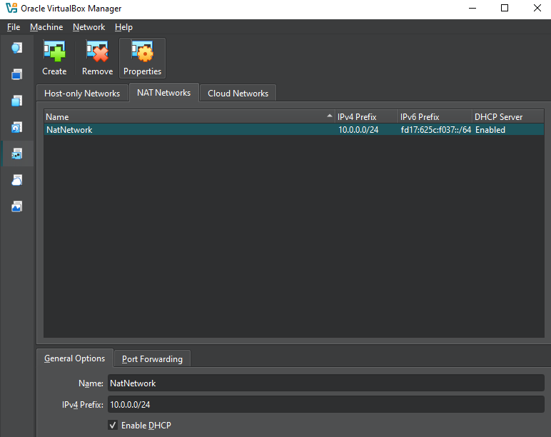
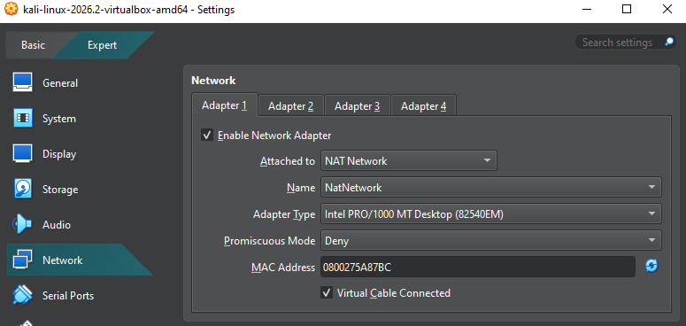
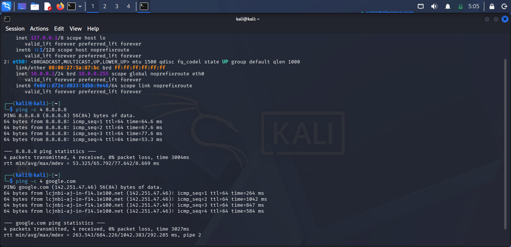
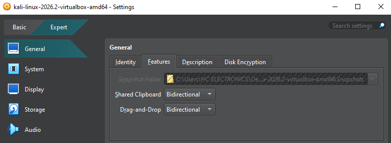
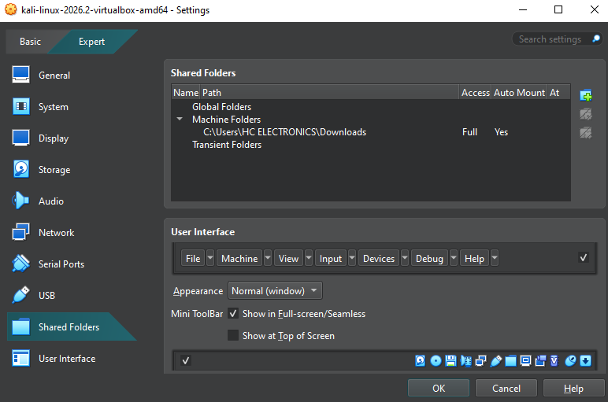
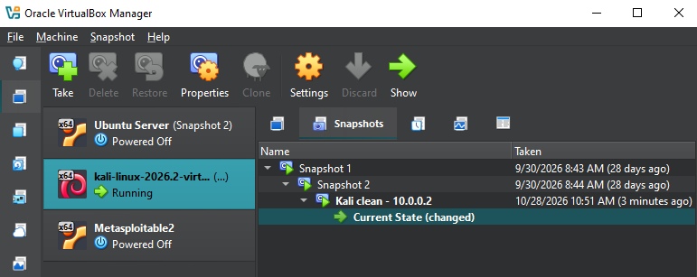

# Cybersecurity Lab Environment Setup

Building an isolated virtual lab for ethical hacking practice (Networkwalks, Batch B084, Week 1 Project)

## Project Overview
This project sets up a virtual cybersecurity lab on my own computer using VirtualBox and Kali Linux. The lab is where I can safely practise scanning, reconnaissance and other security testing skills. It runs on a private virtual network, so anything I test stays inside the lab and never touches real networks or systems that I don't own.

## Tools Used
- VirtualBox 7.2.12 r174389
- Kali Linux 2026.2
- NATNetwork (10.0.0.0/24)

## Setup Steps

### 1. NATNetwork
In VirtualBox, I opened File → Tools → Network and created a NAT Network named `NatNetwork` with the IPv4 prefix `10.0.0.0/24` and DHCP enabled. Every machine I add to the lab later will join this same private network, so they can talk to each other and still reach the internet through the host.

### 2. Kali VM network adapter
In the Kali VM settings, I set Adapter 1 to "NAT Network" and selected `NatNetwork` as the name. I also set Promiscuous Mode to "Allow All" so that Kali can later capture traffic from other machines on the network.

### 3. Static IP and internet access
By default, Kali received a dynamic address from DHCP (10.0.0.3). I changed the connection from automatic to manual and set:
- IP address: `10.0.0.2/24`
- Gateway: `10.0.0.1`
- DNS: `8.8.8.8`

I confirmed the change with `ip a`, which shows `10.0.0.2/24` on eth0. I then tested connectivity with `ping 8.8.8.8` and `ping google.com`. Both replied with 0% packet loss, so the VM has full internet access and working DNS.

### 4. Clipboard and drag-and-drop
I set both Shared Clipboard and Drag-and-Drop to Bidirectional in the VM settings (General → Features). I tested the clipboard by copying text on Windows and pasting it into the Kali terminal, and it worked.

### 5. Shared folder
I shared the Windows Downloads folder with Kali using Settings → Shared Folders, with Full access and Auto-mount turned on. It appears on the Kali desktop as `sf_Downloads`, so I can move files between my main computer and the lab easily.

### 6. Snapshot
Once everything was working, I took a snapshot named "Kali clean - 10.0.0.2". If I break something in a later exercise, I can restore the VM to this clean, working state.

## Troubleshooting
**Problem:** The OK button was greyed out in the Kali network settings, with "Invalid settings detected".
**Cause:** No NAT network existed yet, so the Name field said "Not selected".
**Solution:** I created the NatNetwork under File → Tools → Network first, then selected it in the adapter settings.

## Conclusion
I built a working virtual lab with Kali Linux on an isolated 10.0.0.0/24 network, with a static IP, internet access, a shared clipboard, a shared folder and a restorable snapshot. I learned how VirtualBox NAT networks work, how to set a static IP on Linux, and how to troubleshoot a network setting that wouldn't save. The lab is ready for further machines and security exercises in the coming weeks.

---
*This lab runs on my own computer. All testing is done only in my own virtual environment.*
